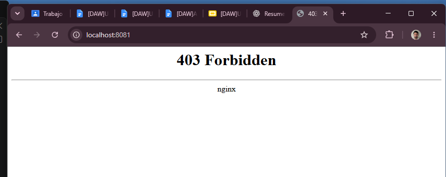
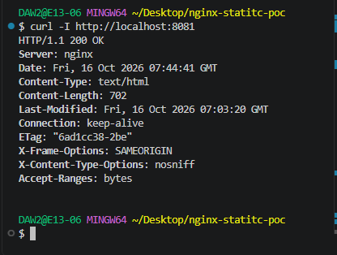
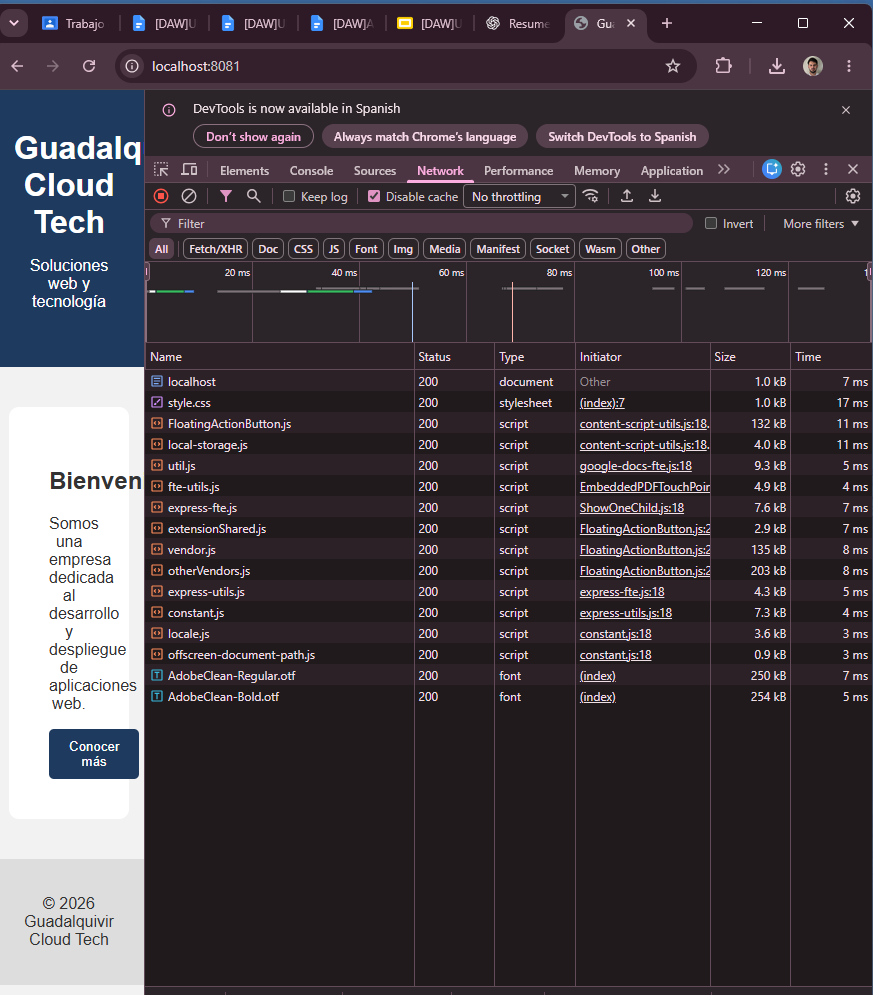
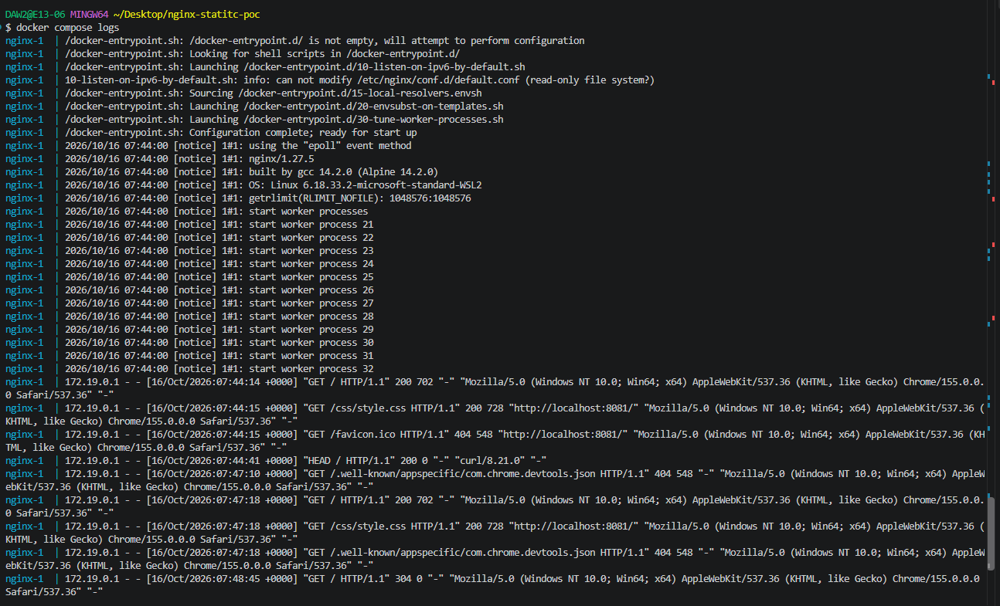

# 1. Descripción

En esta práctica hemos desplegado una página web estática utilizando Nginx dentro de un contenedor Docker.

La página está formada por un archivo HTML y un archivo CSS.

El objetivo es comprobar que Nginx funciona correctamente, que los archivos se cargan y que se aplican algunas medidas básicas de seguridad.

# 2. Funcionamiento

Navegador
    |
    | http://localhost:8081
    v
Puerto 8081 - Host
    |
    | 8081:80
    v
Contenedor Docker
    |
    v
Nginx - Puerto 80
    |
    v
index.html + style.css

# 3. Puerto

He utilizado el puerto 81 ya que el puerto 80 lo usamos para otra actividad de clase.

# 4. Comandos utilizados 

Para construir y levantar el contenedor :

docker compose up -d --build

Comprobar su estado:

docker compose ps

Para ver los logs:

docker compose logs

Para comprobar las cabeceras http:

curl -I http://localhost:8081

# 5. Configuración de nginx

Se ha configurado nginx para usar los archivos de /usr/share/nginx/html

Se ha configurado para evitar que se muestre la verión de nginx con server_tokens off;

Y se han añadido dos cabeceras donde la primera evita que la página se pueda cargar en un iframe con otro origen:

add_header X-Frame-Options "SAMEORIGIN";

Y la segunda evita que el navegador interprete los archivos usando un tipo diferente: 

add_header X-Content-Type-Options "nosniff";

# 6. Error provocado

Hemos cambiado el nombre a index y ha provocado un error 403

# CAPTURA 1 SALIDA DEL COMANDO CURL - L

# CAPTURA 2 PESTAÑA NETWORK

# CAPTURA 3  DOCKER COMPOSE LOGS

